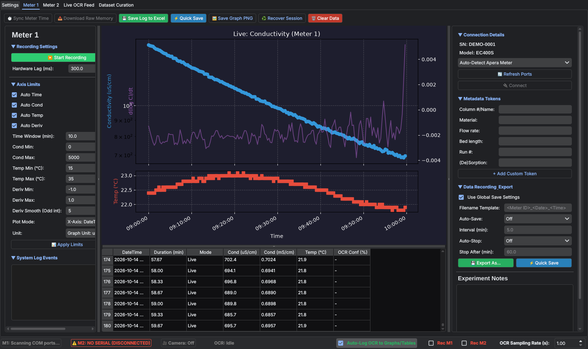

# Apera Conductivity Meter GUI

[](https://github.com/brandonbtm29/Apera-Meter-GUI/actions/workflows/ci.yml)
[](https://github.com/brandonbtm29/Apera-Meter-GUI/releases/latest)
[](LICENSE)

**Log, plot and export readings from one or two Apera conductivity meters at once.**

A desktop app for the Apera EC400S and EC8500 series. Plug the meters in over USB, and the app
finds them, records conductivity and temperature, draws live graphs, and saves everything to
Excel. If the app closes unexpectedly, the session can be recovered. An optional camera mode
reads the meter's display with a small neural network, for meters or moments where the serial
stream isn't enough.



It was built for long column sorption experiments in a university polymer lab, where readings
are needed every few seconds for hours and nobody should have to copy numbers off a display.

## Features

- **Two meters side by side**: each meter gets its own tab, connection, graph, table and save
  settings.
- **Auto-connect**: scans the COM ports for an Apera meter and remembers the last port that
  worked.
- **Live graphs**: conductivity (log scale, µS/cm or mS/cm), its rate of change, and temperature,
  against clock time or elapsed minutes.
- **Meter memory download**: pull the readings stored in the meter, by hand or every few hours.
- **Excel export**: one click saves the table, notes and a chart to `.xlsx`. File names are built
  from tokens such as `<Meter ID>_<Date>_<Time>` plus your own (material, flow rate, run #…).
- **Auto-save and auto-stop**: save every few minutes while recording, and stop after a set time.
- **Crash recovery**: every reading is also written to a backup CSV, and **Recover Session**
  brings it back after a crash or power cut.
- **Discord alerts** (optional): a message when conductivity changes sharply (by a set amount on
  a log scale), with a delay after the start and a cool-down between alerts.
- **Camera reading (OCR)** (optional): point a webcam at the meter, draw a box around the
  display, and the app reads the digits with a trained model. A curation tab helps collect and
  label images for retraining.
- **Shared settings**: keep settings in a synced folder so several computers behave the same.

## Quick start

You need **Python 3.11 or newer**, **Git**, and **[Git LFS](https://git-lfs.com)** (for the
135 MB OCR model; skip it if you won't use the camera).

```bash
git lfs install
git clone https://github.com/brandonbtm29/Apera-Meter-GUI.git
cd Apera-Meter-GUI
python -m venv .venv
```

Then install and start it:

| | Windows (PowerShell) | macOS (Terminal) |
|---|---|---|
| Install | `.venv\Scripts\python -m pip install -e ".[ocr]"` | `.venv/bin/python -m pip install -e ".[ocr]"` |
| Start | double-click `Launch_Windows.bat` | double-click `Launch_Mac.command` |

Leave out `[ocr]` (i.e. `pip install -e .`) to skip PyTorch, which is a large download. The
app still runs; only the camera reading is unavailable.

The app opens without a meter attached, so you can look around first. Plug a meter in, click
**Refresh Ports**, then **Connect** on the Meter 1 tab.

> If Windows shows no COM port for the meter, install the USB driver that comes with Apera's
> PC Link software.

## Using it

| Where | What it does |
|---|---|
| **Meter 1 / Meter 2** tabs | **Connect**, **Start Recording**, **Save Log to Excel**, **Quick Save** (overwrite the auto-save file), **Download Raw Memory**, **Sync Meter Time**, **Recover Session**, **Clear Data** |
| Right panel | Connection, metadata tokens for file names, save/auto-save/auto-stop, experiment notes |
| Left panel | Axis limits, graph units, time vs. duration axis, event log |
| **Settings** tab | Save folder and file-name template for both meters, Discord alerts, settings folder, restart |
| **Live OCR Feed** tab | Camera on/off, draw the reading area, OCR filters and logging |
| **Dataset Curation** tab | Review and label camera crops for retraining the OCR model |

## Where files go

The app keeps **data** and **settings** in separate places.

**Data** (Excel exports, backups, logs, OCR sessions) goes in a data folder, by default:

```
~/SyncThing/UAkron Playground/Electrical Conductivity Meter/
├── Data/            Excel exports (the default save folder)
├── Data Backups/    crash-recovery CSVs, one per meter
└── Sessions/        OCR captures and the training dataset
```

That default suits the lab's SyncThing setup. To use another folder, set an environment
variable before starting the app:

| Variable | Meaning |
|---|---|
| `UAKRON_APP_DATA_DIR` | Use exactly this folder for this app's data |
| `UAKRON_DATA_DIR` | Use `<this folder>/Electrical Conductivity Meter` |
| `UAKRON_SETTINGS_DIR` | Read and write settings in this folder |

**Settings** (`config.json` for meter and app settings, `global_rois.json` for the camera reading
areas) live next to the code by default and are never committed. On the **Settings** tab,
**Settings Folder** can move them to a synced folder; relative paths are inside the data folder,
so `Settings` keeps them identical across computers.

All settings are edited in the app, which writes `config.json` itself; there's no need to edit
it by hand. Treat it as private: it holds your **Discord webhook URLs**, and anyone with a
webhook URL can post to that channel.

## How it works

- **Serial**: each meter tab owns a background thread that talks to the meter at 115200 baud,
  decodes its packets into date, conductivity and temperature, and hands them to the UI. An
  optional keep-alive ping (every 2 s, on by default) keeps the connection active.
- **Recording**: each reading goes to the table, the graph and the backup CSV at the same time.
  Excel files are written with pandas and openpyxl.
- **OCR**: a camera thread grabs frames, crops the area you drew, and runs a CRNN (ResNet-34 +
  LSTM) from `ocr_model.py` with the weights in `meter_ocr_model.pt`. Filters reject impossible
  values before they're logged.

| File | Contents |
|---|---|
| `meter_app.py` | The app: meter tabs, settings tab, OCR tab, main window |
| `ocr_pipeline.py`, `ocr_model.py` | Camera capture, preprocessing and the OCR network |
| `dataset_curation_tab.py` | The labelling tab |
| `settings_location.py` | Where settings are stored (shared with the lab's other apps) |
| `Scripts/` | Build script, log repair (`cleanup_1000x_gaps.py`), screenshot generator |

## Good to know

- Only the **conductivity** and **temperature** readings are logged; other meter modes (pH,
  TDS, salinity…) aren't handled.
- If a log shows sudden 1000× jumps (readings mixing µS/cm and mS/cm),
  `python Scripts/cleanup_1000x_gaps.py <log.csv>` writes a repaired copy next to it.
- The OCR model was trained on images from one lab setup (meter, camera and lighting). On a
  different setup, expect to collect and label new images with the curation tab and retrain.
- If you cloned without Git LFS, `meter_ocr_model.pt` is a small text pointer and OCR won't
  load. Run `git lfs install` and then `git lfs pull` to fetch it.
- `pyqtdarktheme`, used for the dark theme, is no longer maintained. pip installs version 2.1.0
  on Python 3.11 and 0.1.7 on 3.12 and newer; the app works with both.
- `Scripts/build_app.py` builds a single-file executable with PyInstaller. It hasn't been tested
  recently and doesn't bundle the OCR model or icon yet.

## Development

```bash
python -m pip install -e ".[dev]"     # add ,ocr to also run the OCR model test
pytest                                # headless smoke tests; never touch real data
ruff check . && ruff format --check .
python Scripts/make_screenshot.py     # refresh docs/screenshot.png
```

CI runs the same checks on Windows and Linux with Python 3.11–3.13, and scans the full history
for secrets. The version lives in one place, `__version__` in `meter_app.py`; changes are listed
in [CHANGELOG.md](CHANGELOG.md). Security reports: see [SECURITY.md](SECURITY.md).

**Cutting a release:** bump `__version__`, move the "Unreleased" notes in the changelog under the
new version and date, commit, then:

```bash
git tag -a vX.Y.Z -m "Apera Meter GUI X.Y.Z"
git push origin main && git push origin vX.Y.Z
gh release create vX.Y.Z --title "Apera Meter GUI X.Y.Z" --notes-file notes.md --latest --verify-tag
```

## How this was built

Apera Meter GUI is written and maintained by Brandon T. McReynolds with the help of AI coding
assistants. Earlier versions (before October 2026) were co-developed with Google Gemini in
Antigravity. Later versions, from 10 October 2026, were co-developed with Claude (Anthropic);
those commits list Claude as a co-author. Brandon directs the work, reviews and tests the
changes, and is responsible for the project.

## License

[MIT](LICENSE) © 2026 Brandon T. McReynolds
